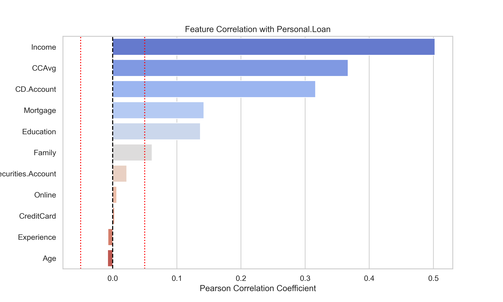
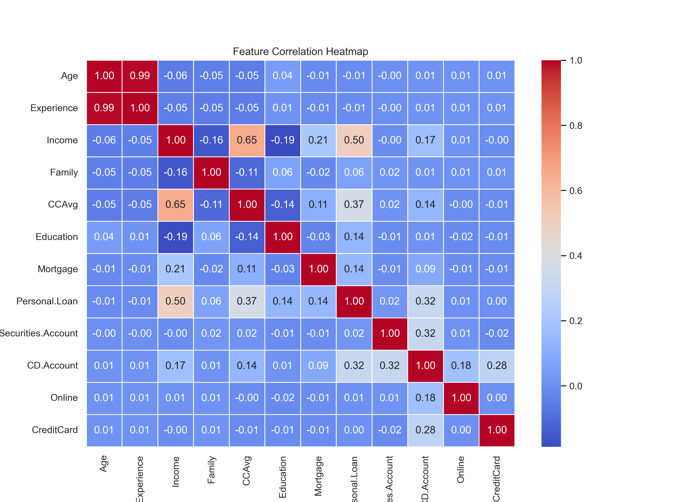
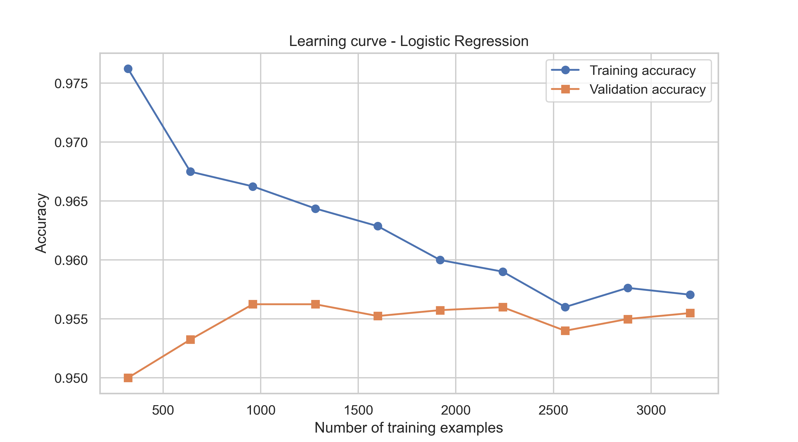
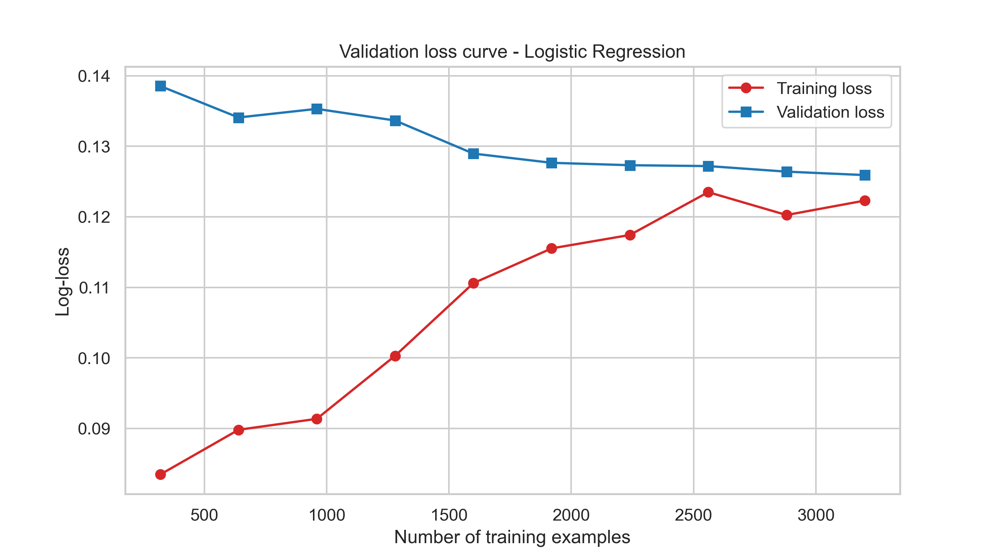
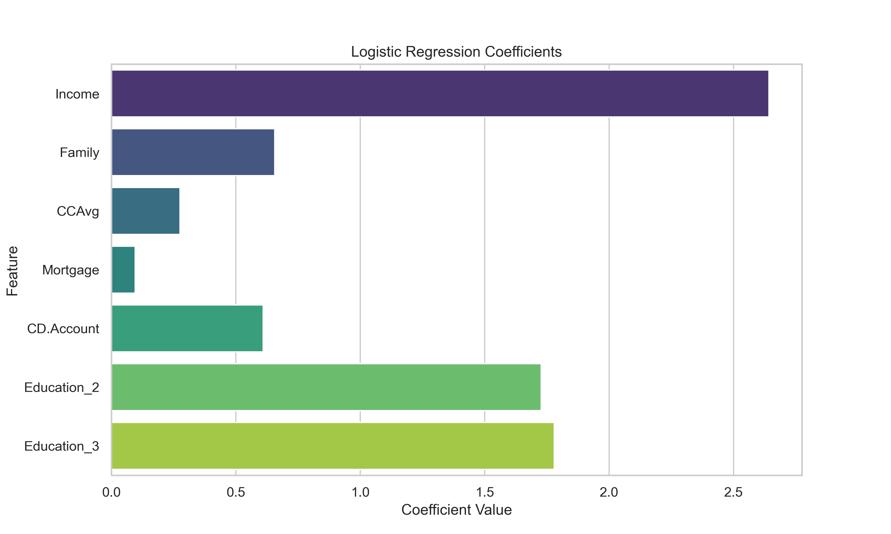
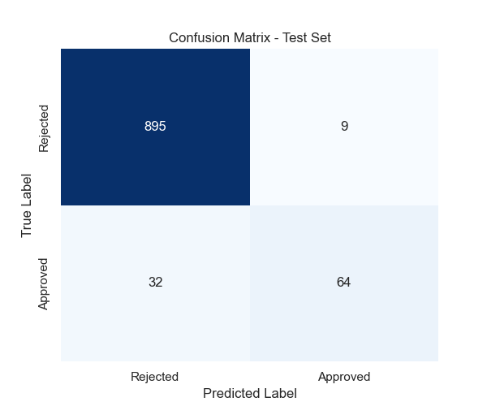

# Project title: Predicting Personal Loan Approval Using Logistic Regression
- Our model uses a customer's details (income, age, credit card spending, mortgage amount) to predict whether their personal loan will be approved or not.

- AI101 Mini-Project, IIT Ropar | Team 51

## Team,Github ID,Role and Entry No.

| Name | GitHub | Role | Entry No. |
|---|---|---|---|
| Abhishek Yadav | abhishek6061-ai | Documentation lead | 2026AIB1003 |
| Rajveer Dabi | rajveer-mcb | Execution lead | 2026MCB1558 |
| Shobhan | shobhan-vn | PPT lead | 2026EEB1423 |
| Shivansh | shivansh-009 | Video lead | 2026EEB1411 |

**All members contributed code to the project.**

## Problem and Dataset
- **Problem:** Banks need to decide which customers are likely to be approved for a personal loan. We predict whether a customer's loan is approved (1) or not (0) from details such as income, age, credit card spending and mortgage amount. This can make lending decisions faster and more consistent.
- **Dataset:** Bank Loan Approval dataset (Kaggle): https://www.kaggle.com/datasets/vikramamin/bank-loan-approval-lr-dt-rf-and-auc
- **Size:** 5000 rows x 14 columns
- **Target variable:** Personal Loan (Binary: 1 for approved/accepted, 0 for rejected/not accepted)
- **Task:** Logistic regression

## Project Structure

```
AI101-mini-project/
├── README.md                 
├── requirements.txt          
├── data/
│   └── bankloan.csv
├── notebook/
    └── your_notebook.ipynb         
├── results/
    ├── Feature Correlation with Personal Loan.png
    ├── Feature Correlation Heatmap.png
    ├── ROC Curve.png
    ├── Validation Loss Curve.png
    ├── Confusion Matrix.png
    └── Learning Curve.png                  
└── slides/
    └── [filename].pdf        
```

## Setup

- Python version: 3.14.6
- **Install libraries:**

```bash
pip install -r requirements.txt
```

## How to Run the Notebook

### Prerequisites
- [Git](https://git-scm.com/downloads)
- [Python 3.14+](https://www.python.org/downloads/)

### Steps

**1. Clone the repository**
```bash
git clone https://github.com/abhishek6061-ai/AI101-mini-project.git
cd AI101-mini-project
```

**2. Create a virtual environment**
Windows (Git Bash):
```bash
python -m venv venv
source venv/Scripts/activate
```

Windows (Command Prompt / PowerShell):
```bash
python -m venv venv
venv\Scripts\activate
```

macOS / Linux:
```bash
python3 -m venv venv
source venv/bin/activate
```
**3. Install dependencies**
```bash
pip install -r requirements.txt
```

**4. Go into the notebook folder**
```bash
cd notebooks
```

**5. Launch Jupyter Notebook**
```bash
jupyter notebook
```
Your browser will open automatically. If it doesn't, copy the `http://localhost:8888/...` link from the terminal.

**6. Open and run the notebook**
- Click `main.ipynb`
- Run all cells: **Kernel → Restart & Run All**
  (or press `Shift + Enter` to run cell by cell)

## Expected Output

Running the notebook produces these plots (copies are saved in `results/`).

### Feature correlation with the target


Income (0.50), CCAvg (0.37) and CD.Account (0.32) have the strongest correlation with loan approval. Age, Experience, Online, CreditCard and Securities.Account fall inside the red dotted +/- 0.05 lines, so they are dropped as weak predictors.

### Correlation heatmap


Age and Experience are almost identical (r = 0.99), so Experience is removed as a redundant feature.

### Learning curve


Training and validation accuracy come together at about 0.955 to 0.957 as the data grows. The small gap shows the model is not overfitting, and more data is unlikely to help much.

### Validation loss curve


Training loss and validation loss move towards each other (about 0.12 to 0.13), which also shows the model generalises well.

### Model coefficients


Income has the largest coefficient, followed by Education_3, Education_2, Family and CD.Account. CCAvg and Mortgage have smaller coefficients.

### Confusion matrix (test set)


895 rejected customers were predicted correctly and 9 were wrongly approved. 64 approved customers were found and 32 were missed.

## Results

Test set: 1000 customers (20% hold-out).

| Metric | Train | Test |
|---|---|---|
| Accuracy | 0.9575 | 0.9590 |
| Precision | 0.8794 | 0.8767 |
| Recall | 0.6458 | 0.6667 |
| F1 Score | 0.7447 | 0.7574 |
| RMSE | 0.2062 | 0.2025 |
| ROC AUC | 0.9581 | 0.9587 |

- **Good overall performance:** The model predicts the right outcome for about 96% of customers and separates approved from rejected customers well (ROC AUC = 0.96).
- **No overfitting:** Train and test scores are almost identical, and the learning and loss curves converge.
- **Precision vs recall:** When the model predicts "approved", it is right 88% of the time. It finds about 67% of the customers who were actually approved, because only 9.6% of customers in the data are approved.
- **Features used:** 7 features remain after the correlation rules: Income, Family, CCAvg, Mortgage, CD.Account, Education_2 and Education_3.

## Slides and Video

- Slides (PDF, 5 slides): [link to slides/filename.pdf]
- Video (3 to 5 minutes, all members speak): [unlisted or public YouTube link]

## AI Tool Disclosure

| Tool | Used for | How we verified it |
|---|---|---|
| Claude | Structuring and wording the README, explaining Git and VS Code errors, and splitting the notebook into parts | Ran every command and the full notebook ourselves and compared the README with the actual repo |
| ChatGPT / other tool, if used | debugging code or explaining concepts | ran the code and compared the results |
